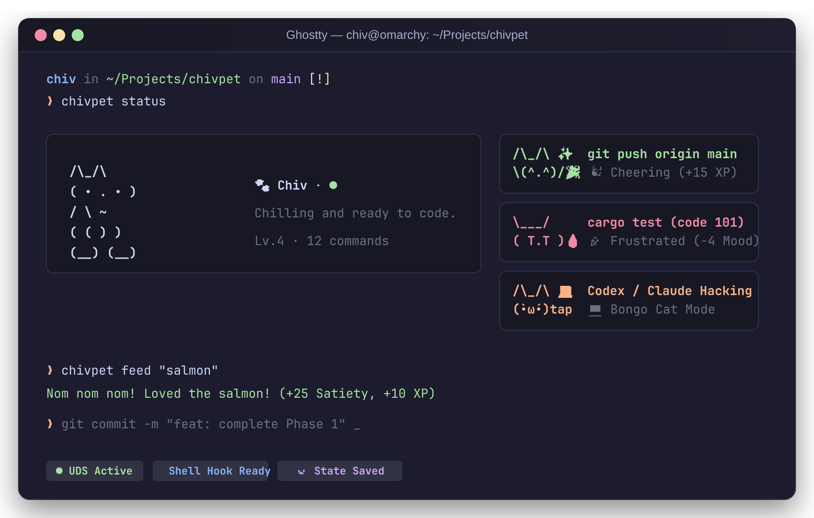
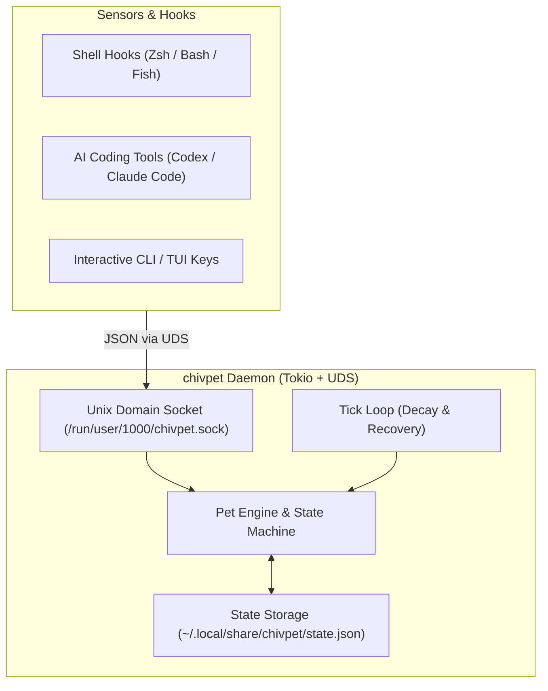

# 🐾 chivpet

> A minimalist, fluidly-animated terminal companion for developer workflows.

<p align="center">
  
</p>

`chivpet` is an intelligent, developer-aware terminal companion designed for Ghostty, Foot, tmux, and modern Linux/Wayland workflows. Unlike standalone toy scripts that freeze your prompt, `chivpet` lives quietly alongside your daily work: it reacts when you `git push`, cheers when tests pass, sympathizes when builds fail, and stays minimal without distracting visual clutter.

---

## ✨ Features

- **Fluid, Handcrafted ASCII Animations**:
  - 🎞️ **11.1 FPS High-Rate Animation**: 8–12 frames per sequence with natural motion physics.
  - 🐱 **Sine-Wave Tail & Eyelid Blinks**: Smooth, organic tail swaying with half-blink eyelid transitions.
  - 💻 **Bongo Cat Hacking**: Alternating paw mechanics slapping the keyboard when commands or AI agents work.
  - 🎉 **Leap & Cheering**: Crouch, spring-up, and cushion landing upon test passes or `git push`.
  - 💤 **Peaceful Loaf Breathing**: Gentle chest rise and fall with drifting `zZz` bubbles.
- **Minimalist & Zen Aesthetic**:
  - 🧼 **Zero Clutter**: No heavy progress bars, no neon rainbow gauges.
  - 🎨 **Terminal-Native Tone**: Calm, clean dual-tone palette matching your dark terminal theme.
  - 📐 **Adaptive Centered Stage**: Scales seamlessly from full windows down to tiny 10-line tmux splits.
- **Zero-Friction Daemon + IPC Architecture**:
  - Runs a lightweight background daemon via local Unix Domain Socket (`$XDG_RUNTIME_DIR/chivpet.sock`).
  - Asynchronous, non-blocking shell hooks (Zsh, Bash, Fish) with `< 0.2ms` dispatch—never delays your prompt.
  - Consumes `< 2MB` RAM in background as a systemd user service.

---

## 🚀 Quick Start

### 1. Build and Install

```bash
git clone https://github.com/chivopic/chivpet.git
cd chivpet
cargo install --path .
```

### 2. Start the Daemon

You can run it directly:
```bash
chivpet daemon
```

Or enable it as a systemd user service (auto-starts on login):
```bash
mkdir -p ~/.config/systemd/user
cat << 'EOF' > ~/.config/systemd/user/chivpet.service
[Unit]
Description=Chivpet Daemon - Terminal Pet Companion

[Service]
ExecStart=%h/.local/bin/chivpet daemon
Restart=on-failure
RestartSec=3

[Install]
WantedBy=default.target
EOF

systemctl --user daemon-reload
systemctl --user enable --now chivpet
```

### 3. Enable Shell Integration

#### Zsh
Add to `~/.zshrc`:
```bash
eval "$(chivpet hook zsh)"
```

#### Bash
Add to `~/.bashrc`:
```bash
eval "$(chivpet hook bash)"
```

#### Fish
Add to `~/.config/fish/config.fish`:
```fish
chivpet hook fish | source
```

---

## 🎮 Usage

### 🖥️ Animated TUI Mode (`chivpet tui`)

Ideal for a small tmux pane, Ghostty split, or corner terminal window:

```bash
chivpet tui
```

**Hotkeys**:
- <kbd>f</kbd> : Feed fish snack
- <kbd>p</kbd> : Pet companion
- <kbd>s</kbd> : Toggle sleep / wake
- <kbd>q</kbd> / <kbd>Esc</kbd> : Quit cleanly

### 📋 CLI Commands

```bash
# Clean, minimal single-view status card
chivpet status

# Output raw JSON (for custom status bars like Waybar)
chivpet status --json

# Feed or interact directly from shell
chivpet feed "salmon"
chivpet pet
chivpet wake
chivpet sleep

# Manually dispatch agent or tool actions
chivpet event agent claude thinking --detail "refactoring"
```

---

## 🏗️ Architecture



---

## 🗺️ Roadmap

- [x] **Phase 1**: Core Daemon, UDS IPC, state machine, CLI commands, and Shell hooks.
- [x] **Phase 2**: Dedicated 11 FPS animated TUI mode (`chivpet tui`) with minimalist aesthetic.
- [ ] **Phase 3**: AI Agent Integration (Codex / Claude Code lifecycle hooks).
- [ ] **Phase 4**: Omarchy / Wayland transparent desktop floating overlay (`wlr-layer-shell`).
- [ ] **Phase 5**: Custom themes and ASCII / pixel sprite sheets.

---

## 📄 License

MIT
