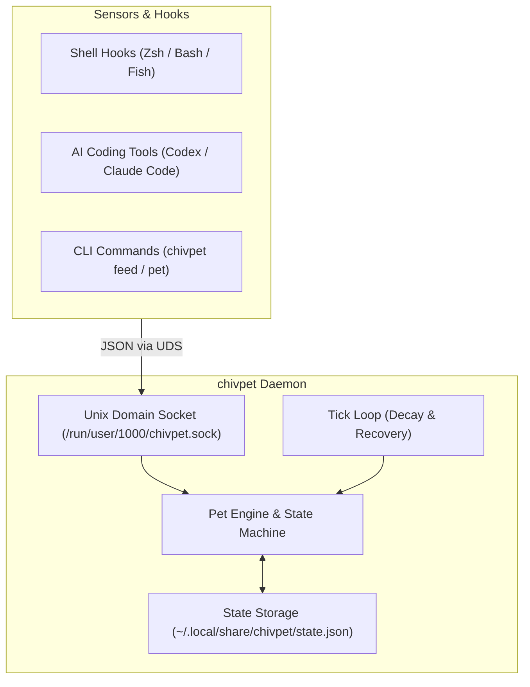

# 🐾 chivpet

> A reactive terminal companion pet for developer workflows.

<p align="center">
  
</p>

`chivpet` is an intelligent, developer-aware terminal pet designed for developers using Ghostty, Foot, tmux, and modern Linux/Wayland workflows. Unlike standalone toy animations that lock up your terminal, `chivpet` lives alongside your daily development: it reacts to your `git push`, cheers when your test suite passes green, gets sad when builds fail, and levels up as you code.

---

## ✨ Features

- **Developer Context Awareness**:
  - 🚀 **`git push` / `commit`**: Celebrates successful pushes and commits.
  - ✅ **Tests & Builds**: Celebrates when `cargo test`, `pytest`, `npm test` pass.
  - 😿 **Error Empathy**: Drops its ears and sympathizes when commands exit with non-zero status.
  - 🐟 **Care & Interaction**: Feed snacks, pet your companion, or put it to sleep.
  - 🌟 **RPG Progression**: Earns XP, levels up, and tracks command statistics.
- **Zero-Friction Daemon + IPC Architecture**:
  - Runs a lightweight background daemon over a local Unix Domain Socket (`$XDG_RUNTIME_DIR/chivpet.sock`).
  - Asynchronous, non-blocking shell hooks (Zsh, Bash, Fish) with `< 1ms` dispatch overhead—never slows down your prompt.
  - Offline-resilient: CLI commands gracefully display saved state even if the daemon isn't running.

---

## 🚀 Quick Start

### 1. Build and Install

```bash
git clone https://github.com/chivopic/chivpet.git
cd chivpet
cargo install --path .
```

### 2. Start the Daemon

```bash
# In a background service, terminal multiplexer, or systemd user service:
chivpet daemon
```

### 3. Enable Shell Integration

#### Zsh
Add the following line to `~/.zshrc`:
```bash
eval "$(chivpet hook zsh)"
```

#### Bash
Add the following line to `~/.bashrc`:
```bash
eval "$(chivpet hook bash)"
```

#### Fish
Add the following line to `~/.config/fish/config.fish`:
```fish
chivpet hook fish | source
```

---

## 🎮 CLI Usage

```bash
# View pet status, level, mood, energy, and stats
chivpet status

# Launch interactive animated TUI (ideal for tmux / Ghostty split panes)
chivpet tui

# Output raw JSON (useful for custom status bars like Waybar)
chivpet status --json

# Feed your pet some food
chivpet feed "tuna"

# Pet your companion
chivpet pet

# Wake up or send to sleep
chivpet wake
chivpet sleep

# Manually report an agent or tool action
chivpet event agent claude thinking --detail "analyzing codebase"
```

---

## 🏗️ Architecture



---

## 🗺️ Roadmap

- [x] **Phase 1**: Core Daemon, UDS IPC, state machine, CLI commands, and Shell hooks.
- [x] **Phase 2**: Dedicated TUI mode with Ratatui for tmux / Zellij panes.
- [ ] **Phase 3**: AI Agent Integration (Codex / Claude Code lifecycle hooks).
- [ ] **Phase 4**: Omarchy / Wayland transparent desktop floating overlay (`wlr-layer-shell`).
- [ ] **Phase 5**: Custom themes and ASCII / pixel sprite sheets.

---

## 📄 License

MIT
